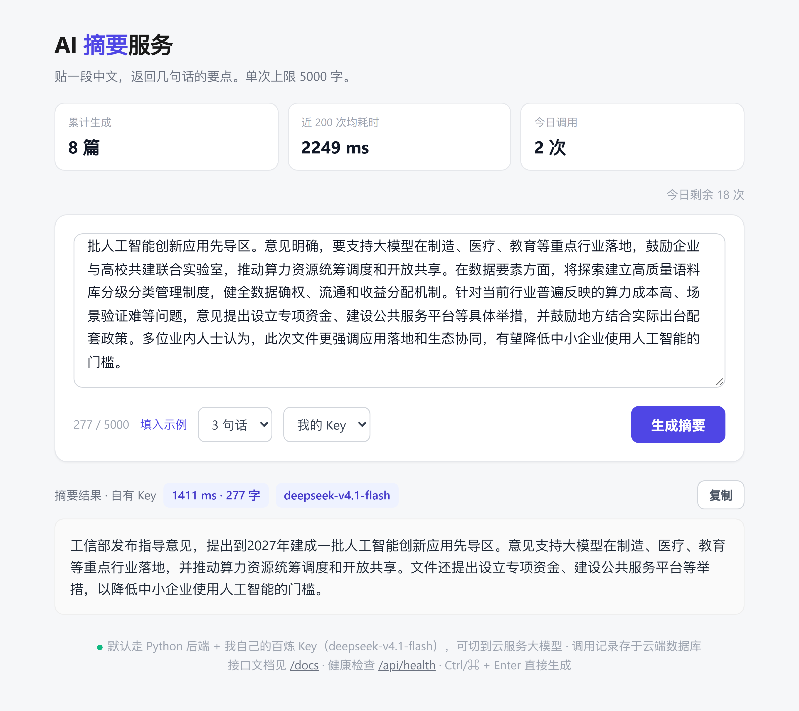

# 大模型文本摘要器（ai-summary-bot）

用 Python 调用大模型 API，把长文本压缩成指定句数的中文摘要。既是**命令行工具**（读文件、控制长度、失败自动重试、日志落盘、只改环境变量即可切换任意 OpenAI 兼容的大模型服务），也是**可对外的 Web 服务**（FastAPI + 单页前端 + 接口文档），另有**批量模式**（CSV 逐行摘要、逐行容错、断点续跑）。

> 这是一个**从零搭建**的练手项目（不是跟教程抄的），目的是把「大模型应用开发」需要的工程化环节完整走一遍：
> 依赖管理 → 面向对象设计 → 异常分级 → 装饰器重试 → 单元测试 → 日志落盘 → 多厂商可插拔 → 版本发布。



---

## 功能特性

| 特性 | 说明 |
|---|---|
| 读取文件生成摘要 | 支持 `.txt` / `.md`，不再受 `input()` 只能读一行限制 |
| 可调摘要长度 | `--length` 指定摘要句数 |
| 失败自动重试 | API 超时 / 网络抖动 / 429 限流 / 5xx → 指数退避重试（1s → 2s → 4s） |
| 错误分级 | 401 / 402 这类不可恢复错误**立即失败**，不做无谓等待 |
| 调用日志落盘 | 每次运行的关键信息和错误写入 `logs/app.log`，跑批量任务出问题可事后排查 |
| **多厂商可切换** | 换服务商只改 `API_BASE_URL` / `MODEL_NAME` 两个环境变量，**代码一行不动** |
| 失败可被脚本感知 | 成功退出码 `0`、失败 `1`，可以直接用在 shell 脚本 / CI 里判断 |

---

## 环境要求

- **Python 3.10+**（本项目在 3.14.5 上开发）
- 任意 **OpenAI 兼容**的大模型服务 API Key。代码默认指向 DeepSeek 官方（<https://platform.deepseek.com/> 注册后在「API keys」页面创建）；本仓库当前 `.env` 实际用的是**阿里云百炼**的兼容端点 + `deepseek-v4.1-flash`，换厂商见下方「切换到其他服务商」
- 依赖库：`requests`；跑测试需要 `pytest`

---

## 安装

```bash
git clone https://github.com/ycj200683-bit/ai-summary-bot.git
cd ai-summary-bot

# 建虚拟环境（推荐，避免污染全局环境）
python -m venv .venv
# Windows
.venv\Scripts\activate
# macOS / Linux
source .venv/bin/activate

pip install -r requirements.txt          # 运行依赖
pip install -r requirements-dev.txt      # 想跑测试再装这个
```

### 一键启动（Windows）

环境建好之后，不用每次敲命令，双击根目录的脚本即可：

| 双击 | 做了什么 | 地址 |
|---|---|---|
| `启动.bat` | 本地起服务 + 3 秒后自动开浏览器 | <http://127.0.0.1:8000> |
| `固定域名.bat` | 起服务 + Cloudflare 隧道 | 自己的固定域名 |

`启动.bat` 还支持在命令行里传参切换分享模式：

```bat
启动.bat lan      局域网（同一 WiFi 下可访问）
启动.bat tunnel   临时公网链接（地址每次变）
启动.bat named    固定域名（走 Cloudflare Tunnel，默认 8001 端口）
```

脚本内置三项检查：`.venv` 不存在时给出建环境命令、缺 `.env` 时告警、端口被占用时自动让到下一个。

> **改 bat 时注意编码**：这两个文件是 **GBK** 存的。用 VS Code 等编辑器改动后别存成 UTF-8，否则 cmd 解析中文会错位，报出一堆 `'RT' 不是内部或外部命令` 之类的怪错。

### 配置（写在 `.env` 里，或直接用环境变量）

配置项**不写进代码**，所以 key 不会被提交到仓库。两种给法，任选一种：

**① 推荐：写进项目根目录的 `.env`**（已在 `.gitignore` 里，推不上仓库）

```ini
API_KEY=你的key
API_BASE_URL=https://dashscope.aliyuncs.com/compatible-mode/v1
MODEL_NAME=deepseek-v4.1-flash
DISABLE_THINKING=1
```

`python main.py`、`python -m uvicorn app:app` 都会自己读它，不用每次开终端都 export 一遍。

**② 或者直接用环境变量**（优先级更高，相同名字时以环境变量为准）

```powershell
# Windows（PowerShell）
$env:API_KEY = "你的key"

# Windows（Git Bash）/ macOS / Linux
export API_KEY="你的key"
```

| 环境变量 | 是否必填 | 默认值 | 说明 |
|---|---|---|---|
| `API_KEY` | **必填** | 无 | 服务商的 API Key。未设置时程序直接退出并提示（不会带着空 key 去白白请求一次） |
| `API_BASE_URL` | 可选 | `https://api.deepseek.com/v1` | 服务地址。**写 base 或写完整 URL 都行**，代码会自动补 `/chat/completions`，结尾多打的斜杠和空格也会处理掉 |
| `MODEL_NAME` | 可选 | `deepseek-chat` | 模型名。本项目当前用 `deepseek-v4.1-flash`（走百炼）；也可填 `deepseek-chat` / `qwen-plus` / `gpt-4o-mini` / `qwen2.5:7b` 等 |
| `DISABLE_THINKING` | 可选 | 关 | 设成 `1` 关闭"深度思考"。摘要不需要推理，开着只是白等——同一篇 2320 字文章要 5 句：开思考 15.9 s，关思考 2.2 s。只对支持该参数的模型有效 |

> 兼容旧配置：只设 `DEEPSEEK_API_KEY`（不含 `API_KEY`）也仍然能跑，不会因为升级就报错。
>
> `.env` 里能写的东西只有三样，别塞注释以外的花活：一行一个 `KEY=VALUE`，`#` 开头的行会被跳过，值两端的引号会自动剥掉。

### 切换到其他服务商

只要对方提供 OpenAI 兼容接口，改两个环境变量就能切，**代码一行不用动**：

```powershell
# 例：阿里云百炼
$env:API_KEY      = "sk-百炼的key"
$env:API_BASE_URL = "https://dashscope.aliyuncs.com/compatible-mode/v1"
$env:MODEL_NAME   = "qwen-plus"

# 例：本地 Ollama（不用 key，随便填一个非空值即可）
$env:API_KEY      = "ollama"
$env:API_BASE_URL = "http://localhost:11434/v1"
$env:MODEL_NAME   = "qwen2.5:7b"

# 例：OpenAI 官方
$env:API_KEY      = "sk-..."
$env:API_BASE_URL = "https://api.openai.com/v1"
$env:MODEL_NAME   = "gpt-4o-mini"
```

改完直接跑，日志第一行会告诉你当前实际连到哪去了：

```
14:52:14 | INFO    | 🤖 模型：qwen-plus ｜ 端点：https://dashscope.aliyuncs.com/compatible-mode/v1/chat/completions
```

---

## 用法

```bash
python main.py --file sample.txt
```

### 参数表

| 参数 | 类型 | 默认值 | 说明 |
|---|---|---|---|
| `--file` | 路径 | 无 | 要摘要的文本文件。**不传则进入交互模式**，手动粘贴文本 |
| `--length` | 整数 | `3` | 摘要句数，会写进系统提示词；句数不符会自动重写一次 |
| `-h` / `--help` | — | — | 查看帮助 |

### 示例 1：摘要一个文件

```bash
python main.py --file sample.txt
```

```
14:52:14 | INFO    | 📄 已读取文件：sample.txt（359 字）
14:52:14 | INFO    | 🤖 模型：qwen-plus ｜ 端点：https://dashscope.aliyuncs.com/compatible-mode/v1/chat/completions

--- 摘要结果 ---

人工智能正深刻改变软件开发与产品设计流程：开发者可用自然语言生成代码初稿，
产品经理可快速产出调研问卷、分析反馈和竞品框架，大幅提升效率。
但 AI 生成内容存在缺陷风险与业务理解局限，需更严格的人工评审；
其本质是辅助工具，无法替代人的专业判断与业务洞察。
核心价值不在于替代人力，而在于将人从重复劳动中解放，聚焦于更高阶的决策
——"做什么"和"为什么做"。
```

> 前两行是 `logging` 输出（自动带时间戳，同时落盘到 `logs/app.log`），
> 后面是 `print` 输出。**判据**：给开发者看的记录走 logging，给用户看的结果走 print。
>
> 上面这次运行恰好是用**百炼 qwen-plus** 跑的——同一份代码，只换了环境变量。

### 示例 2：自定义摘要句数

```bash
python main.py --file sample.txt --length 5
```

`--length 5` 会把系统提示词里的约束改成「写正好 5 句话」，并要求一共 5 个句号。

> 早期版本写的是「5 句话以内」——那是上限而不是目标，模型给 4 句也算完成任务，
> 于是用户点「5 句」却拿到 4 句。现在改成目标句数，并在拿到结果后数一遍标点：
> 不符就带着「你刚才写了 N 句」的纠正要求重写一次（只重试一次，避免成本翻倍）。
>
> **但"正好 N 句"不能无脑执行**：原文只有 69 个字却要 5 句，模型会把一句话劈成两句，
> 出现「……气候干燥。冬季寒冷。」这种残句。所以句数按正文字数封顶：
>
> | 正文字数 | 最多几句 |
> |---|---|
> | < 200 | 2 |
> | 200 ~ 599 | 3 |
> | 600 ~ 1499 | 4 |
> | ≥ 1500 | 5 |
>
> 收窄发生时，命令行会打一行 `📏 正文 69 字，5 句会拆碎，按 2 句生成`，
> 网页会在结果标题后面注明「原文 69 字，按 2 句给出」，接口通过 `sentences_used` 返回实际句数。

### 示例 3：API 出错时

程序**不会崩**，会打印明确的原因，并把错误记进日志。

不可恢复错误（key 无效 / 余额不足）——立即失败，不重试：

```
14:22:05 | INFO    | 📄 已读取文件：sample.txt（359 字）
14:22:05 | INFO    | 🤖 模型：deepseek-chat ｜ 端点：https://api.deepseek.com/v1/chat/completions
14:22:06 | ERROR   | ❌ 401/403 key 不对或没权限，别重试，去检查 key
```

可恢复错误（429 限流 / 超时 / 5xx）——自动重试，过程也记进日志：

```
14:23:09 | INFO    | 🤖 模型：deepseek-chat ｜ 端点：https://api.deepseek.com/v1/chat/completions
14:23:10 | WARNING | 🔁 第 1 次失败（429 被限流了，等一会儿可以重试），1 秒后重试……
14:23:13 | WARNING | 🔁 第 2 次失败（429 被限流了，等一会儿可以重试），2 秒后重试……
```

换厂商时最容易踩的坑：**只改了端点，忘了改模型名**（这是真实跑出来的输出）：

```
14:54:26 | INFO    | 🤖 模型：deepseek-chat ｜ 端点：https://dashscope.aliyuncs.com/compatible-mode/v1/chat/completions
14:54:26 | ERROR   | ❌ 404 找不到接口或模型。若刚换过厂商，请检查 API_BASE_URL 和 MODEL_NAME 是否配套改了。
                     服务端原文：{"error":{"message":"The model `deepseek-chat` does not exist...","code":"model_not_found"}}
```

> 看出来了吗——报错上方那行日志已经把「当前模型是 `deepseek-chat`、端点却是百炼」摊在眼前了，配置错位一眼可见。这也是为什么要专门打那行启动日志。

连 key 都没设时——连请求都不会发出去：

```
❌ 没找到环境变量 API_KEY（旧名 DEEPSEEK_API_KEY 也认）。请先设置：
   PowerShell: $env:API_KEY="你的key"
   Git Bash  : export API_KEY="你的key"
   可选：$env:API_BASE_URL / $env:MODEL_NAME 换厂商
```

**退出码**：成功 `0`，失败 `1`（包括没设 key 的情况）。所以在脚本或 CI 里可以直接用退出码判断，不必去 grep 输出文本。

---

## Web 服务（FastAPI）

命令行之外，同一套摘要能力也通过 HTTP 暴露出来了，别人不用装 Python 就能用。

```bash
python -m uvicorn app:app --reload --port 8000
```

打开 <http://127.0.0.1:8000> 是网页界面，<http://127.0.0.1:8000/docs> 是自动生成的 API 文档（Swagger UI，可以直接在页面上试接口）。

### 接口

| 方法 | 路径 | 说明 |
|---|---|---|
| `GET` | `/` | 网页界面（`web/index.html`，前后端物理分开） |
| `GET` | `/api/health` | 健康检查：返回模型名、是否已配置、限额 |
| `POST` | `/api/summarize` | 单条摘要（**主链路**，走自己的模型 key：百炼 · `deepseek-v4.1-flash`） |
| `POST` | `/api/quota/take` | 取一次额度（云服务链路调用前先来这里记账） |

请求示例：

```bash
curl -X POST http://127.0.0.1:8000/api/summarize \
  -H "Content-Type: application/json" \
  -d '{"text": "要摘要的正文……", "length": 3}'
```

```json
{
  "summary": "……",
  "latency_ms": 1988,
  "input_chars": 127,
  "model": "deepseek-v4.1-flash",
  "sentences_used": 3,
  "remaining": 19
}
```

`sentences_used` 是实际用了几句（正文太短会被收窄）；`remaining` 是这个 IP 今天还剩几次，页面右上角就显示它。

### 两条生成链路（页面上可切换）

| 链路 | 走哪里 | 花谁的额度 | 特点 |
|---|---|---|---|
| **我的 Key**（默认） | 浏览器 → `POST /api/summarize` → 自己的模型 key | 自己的 | 成本可控、额度自己说了算；不依赖任何外部脚本，最快 |
| 云服务 | 浏览器 → 云服务 SDK → 平台大模型（流式） | 平台的 | 边收边渲染；但要多加载一个 CDN 脚本，网络不好时可能加载失败 |

> CDN 引的是**写死的版本号**（`@0.1.4`），不是 `@dev` / `@latest`。浮动标签会跟着上游发布自动变，某天一个 breaking change 推上来页面就白屏，而你本地什么都没改、查半天查不出来。升级时手动改数字，改完自己点一遍。

设计要点：

- **两条链路都写同一张云端表 `summary_stats`**（只存字数、耗时、模型名，不存正文，也不存摘要内容）。
- **额度不能重复扣**：`/api/summarize` 服务端内部已经记过一次账，前端走这条路时**不再**调 `/api/quota/take`；只有云服务链路才需要前端先取额度。
- **云服务不可用时自动回退**：jsDelivr 在国内不稳，SDK 拿不到时点「云服务」不会卡死，而是自动改用「我的 Key」并在页面顶部说明一句——自有 Key 这条路不依赖任何外部脚本，永远能走。

### 这一层的三个设计决定

| 决定 | 原因 |
|---|---|
| **不用 `Config.from_env()` 直接初始化** | 它在没配 key 时会 `raise SystemExit`。命令行里这是"程序退出"，在服务里会把整个进程带崩。改成惰性创建 + 返回 503，服务能启动、能说清原因 |
| **每个 IP 每天 20 次 + 全站每天 300 次** | 公开部署后，背后是真金白银的 API 账单。不限流的话，一个脚本就能把额度刷光。单 IP 限额能换 IP 绕过，所以再加一道全站闸门 |
| **Pydantic 做入参校验** | `text` 限 1~5000 字、`length` 限 1~5，超了自动返回 422，不用自己写 if |

关于限流的三条坑（都已处理，写在代码注释里）：

| 坑 | 处理 |
|---|---|
| **先扣费再校验** | 纯空白正文（`" "`）能通过 `min_length=1`，以前会被扣一次额度再返回 400。现在先 `strip()` 校验、再扣费 |
| **`X-Forwarded-For` 可伪造** | 以前取第一段，换 25 个假 IP 能绕过 20 次限额。现在：直连来源是公网 IP 就完全不信 XFF；是内网/回环（说明前面有反代）才取**最后一段**——最后一段是最近一跳代理追加的，客户端改不了 |
| **计数存在进程内存** | 重启清零；`--workers N` 时每进程各记一份，全站上限变成 N 倍。要多进程就先换 Redis |
| **账本只增不减 + 并发穿透** | `_usage` 每天清一次过期 IP，否则 IP 越攒越多；`check_quota()` 整段加锁，否则并发时"读-判断-写"不是原子的，20 个请求同时到可能全都放行 |

> `/api/health` 会返回 `quota_scope: "process-memory"`，部署时一眼能看到当前实例的计数口径。

---

## 怎么给别人用

`uvicorn app:app` 默认只绑 `127.0.0.1`，**只有本机能开**。要让别人访问，看你要给谁用：

| 场景 | 用什么 | 成本 | 代价 |
|---|---|---|---|
| **有自己的域名（最推荐）** | `python share.py --named` | 0 | 电脑要开着；地址永久不变 |
| 同一个 WiFi / 校园网（同学、室友、面试现场） | `python share.py` | 0 | 对方必须在同一个网络 |
| 临时发个链接给人看一眼 | `python share.py --tunnel` | 0 | 地址每次变，你电脑不能关 |
| 不想靠自己的电脑 | 云服务器 / Render / Railway | 有免费档 | 要配环境变量、可能休眠 |

### 一、局域网（最快，5 秒）

```bash
python share.py
```

脚本会打印两个地址：

```
你自己打开：       http://127.0.0.1:8000
同一个 WiFi 的人：  http://10.160.220.105:8000     ← 把这个发出去
```

> 内网 IP 每换一次网络就会变（家里 / 宿舍 / 教室各不同），所以必须现查。查法有讲究：
> 只靠「连一下外网看系统选哪块网卡」在开了 **Clash / V2Ray 的 TUN 模式**时会返回 `198.18.0.1`（fake-IP 网关），
> 在装了 **VirtualBox** 的机器上会返回 `192.168.56.1`（Host-Only 网卡）——这两个地址别人都连不上。
> 现在改成先枚举本机所有 IPv4，排除虚拟网段（`198.18.0.0/15`、`192.168.56.0/24`、`172.17.0.0/16`、`169.254.0.0/16`），
> 再从剩下的 RFC1918 私网地址里挑，拿不到才退回原来的方法。

第一次启动 Windows 会弹「是否允许 Python 访问网络」，必须点**允许**，否则别人能连上但页面打不开。

### 二、固定域名（Cloudflare Tunnel，推荐）

有自己的域名时用这个：地址永久不变，写进简历、发给面试官都行。

```bash
python share.py --named
```

```
  AI 摘要服务已启动（端口 8001）

  你自己打开：       http://127.0.0.1:8001
  同一个 WiFi 的人：  http://10.160.220.105:8001
  固定域名：         https://ai.example.com
       ↳ 地址永久不变；电脑睡眠 / 断网会断，醒来重跑这条命令即可
```

**一次性配置**（只做一次，之后每次只要上面那条命令）：

```bash
# 1. 登录（会打开浏览器，选你的域名授权）
cloudflared tunnel login

# 2. 建隧道
cloudflared tunnel create ai-summary

# 3. 在 ~/.cloudflared/config.yml 里写 ingress 规则，把域名指到本地端口
#    tunnel / credentials-file 填第 2 步给你的隧道名和 uuid
#    ingress:
#      - hostname: ai.example.com
#        service: http://127.0.0.1:8001
#      - service: http_status:404

# 4. 建 DNS 记录（CNAME → <uuid>.cfargotunnel.com，自动开橙云）
cloudflared tunnel route dns ai-summary ai.example.com
```

配置写完 `python share.py --named` 会自动从 `config.yml` 里读出映射到当前端口的域名并打印，不用手记。

几个要点：

- **端口别用 8000**：`--named` 默认 8001。同一个隧道可以挂多个域名（各指不同端口），但两个服务用同一个端口，先起的那个会把端口占死（`[Errno 10048]`）。
- **一个隧道挂多个域名**是标准做法，加服务就在 `ingress` 里加一条 `hostname`，不用再建隧道、不用多跑一个进程。
- **橙云是正常的**：`route dns` 建出来的记录默认走 Cloudflare 代理（橙云），HTTPS 由 CF 提供，隧道后端无所谓。
- **关机 / 睡眠就断**，重跑命令即可，域名不用改。

### 三、公网临时链接（发微信就能用）

```bash
python share.py --tunnel
```

多出来一行：

```
公网链接（谁都能开）： https://illustrated-rss-assembled-encoding.trycloudflare.com
```

走的是 Cloudflare 快速隧道，不用公网 IP、不用域名、不用注册账号，HTTPS 也是自动的。没装 cloudflared 的话：`winget install --id Cloudflare.cloudflared`。

三个必须知道的限制：

1. **关掉就失效**，重启会换一个新地址——它不是永久部署，只适合当场给人看一眼。
2. **电脑睡眠 / 断网就断**，因为服务跑在你自己机器上。
3. **新域名下「云服务」链路和顶部统计会失效**：云端只认白名单里的域名，别家的 Origin 一律拒绝（浏览器报 `Failed to fetch`）。主链路「我的 Key」不受影响，页面也会自动把云服务选项标灰。要用云服务链路，得去云服务后台把新域名加进白名单。

### 四、长期部署（Render，可选）

仓库根目录已经有 `render.yaml`（Blueprint），配置和代码放在一起，不用在网页上凭记忆填环境变量。

**步骤**

1. Render 控制台 → **New → Blueprint** → 选 GitHub 仓库 `ai-summary-bot`
2. Render 读 `render.yaml` 自动建服务，只让你填 **`API_KEY`**（`sync: false` 的项）
3. 等构建完成，拿到 `https://<服务名>.onrender.com`

`API_KEY` 必须手填——仓库里没有 `.env`（被 `.gitignore` 拦住），`render.yaml` 里也只写了 `sync: false` 不写值。**密钥一旦写进仓库文件就等于公开**，这条没有例外。

**免费档要知道的两件事**

| 限制 | 影响 |
|---|---|
| 15 分钟没流量就休眠 | 休眠后第一次访问要等 **约 50 秒** 冷启动。面试前先自己访问一次把它叫醒 |
| 实例 IP 共享、内存 512 MB | 够跑这个服务；但限流账本在进程内存里，重启清零 |

**只改 `render.yaml` 里这三行就能换厂商：**

```yaml
- key: API_BASE_URL
  value: https://dashscope.aliyuncs.com/compatible-mode/v1
- key: MODEL_NAME
  value: deepseek-v4.1-flash
- key: DISABLE_THINKING
  value: "1"
```

**Render 后面取真实 IP 的细节**：Render 是反向代理，`request.client.host` 拿到的是内网地址。`client_ip()` 会自动识别"来源是内网 → 说明有反代"，然后**从 X-Forwarded-For 右边往左找第一个公网地址**。之所以不是直接取最后一段：Render 会把代理自己的内网地址追加在末尾，直接取最后一段会让所有访客算成同一个 IP，20 次/天的限额被几十个人瞬间分完。这条逻辑有 8 个单测覆盖（公网来源忽略 XFF、跳过尾部代理、多级代理、全内网兜底、伪造非 IP 串、`TRUST_PROXY` 强制）。

### 五、如果走 Render：给它绑自定义域名

> 已经用第二节的 Cloudflare Tunnel 就不用看这节——隧道本身就是给域名用的，不存在"再绑一次"。
> 这节只适用于「服务跑在 Render 上，想让域名指过去」的情况。

有域名的话就别用 `onrender.com` 那个地址了——简历上和名片上都不好看，而且免费实例换服务名就变。

**1. Render 侧：加 Custom Domain**

服务页 → Settings → Custom Domains → Add Custom Domain → 填子域名，比如 `ai.example.com`。
Render 会返回一个 CNAME 目标值，通常是 `<服务名>.onrender.com`。

**2. Cloudflare 侧：加 CNAME 记录**

DNS → Records → Add record：

| 字段 | 值 |
|---|---|
| Type | `CNAME` |
| Name | `ai`（只填前缀，CF 会自动补全域名） |
| Target | `<服务名>.onrender.com`（Render 给的那个） |
| Proxy status | **DNS only（灰云）** ← 关键 |

**3. 回 Render 点 Verify，等证书签发（几分钟）**

**为什么必须灰云（DNS only）**

Cloudflare 橙云会在 Render 前面再加一层代理，Render 签发 Let's Encrypt 证书时做的域名验证会被 CF 拦掉，结果是「域名能开但证书报错」或者干脆 522。要开橙云也不是不行，但得把 SSL/TLS 模式改成 Full (strict) 且 Render 侧证书已签好——多一层配置多一个坏点，对一个演示服务不划算。

**绑完后会掉一条链路，这是预期内的**

新域名等于新 Origin，云端白名单里没有它 → 「云服务」链路会被拒（`Failed to fetch`），顶部统计也读不到。主链路「我的 Key」完全正常。

页面已经处理了这种情况：`refreshStats()` 一旦失败就把云服务选项标灰并挂上原因提示，不会让你点了才撞墙。要让云服务链路也恢复，去云服务后台把 `ai.example.com` 加进白名单即可。

### 公开之前先想一件事

**别人用的是你的 API 额度。** 目前的口子是每 IP 每天 20 次 + 全站每天 300 次（`app.py` 顶部改）。按 `deepseek-v4.1-flash` 的价格，全站刷满一天也就是几毛钱，可接受；但如果你换成贵模型，先把 `MAX_CALLS_PER_DAY_GLOBAL` 调小再发链接。

另外限流记录的是**进程内内存**：服务重启清零，`--workers N` 会失效成 N 倍。真要长期开放，先把账本换 Redis。

---

## 运行测试

测试**不会真的调用 API**（不花钱、不联网、结果稳定）：用 `monkeypatch` 把 `requests.post` 换成假函数，人为造出 200 / 401 / 429 各种响应；Web 层则把 `Summarizer` 换成固定返回的替身。

```bash
python -m pytest -q        # 想看每条用例的名字，加 -v
```

预期输出：

```
tests\test_app.py ..................                                      [ 39%]
tests\test_main.py ............................                          [100%]

============================= 46 passed in 0.73s ==============================
```

- `tests/test_main.py`：摘要内核。重试策略、句数收窄、排版规整、配置解析。
- `tests/test_app.py`：HTTP 壳。限流、扣费时机、真实 IP 判定（含多级代理 XFF）、响应字段。这一层以前没有测试，所以「伪造 XFF 绕过限额」「空白正文白扣额度」两个问题上线时都没被发现。

28 条用例分六类：

| 类别 | 覆盖内容 |
|---|---|
| 提示词拼装 | `--length` 是否真的写进了系统提示词 |
| 网络行为 | 正常返回；401 立即失败且**只请求 1 次**；429 重试成功后共请求 3 次（并断言退避时长为 `[1.0, 2.0]`）；404 的报错信息必须提示去检查配置 |
| 配置解析 | URL 归一化 5 种输入、默认值、新旧变量名优先级、空字符串回退、缺 key 直接退出 |

> ⚠️ 测试文件只能用 `pytest` 跑，**不要用编辑器右上角的 ▶ 运行**——那是「当脚本执行」，`sys.path` 里只有 `tests/`，会报 `ModuleNotFoundError: No module named 'main'`。

---

## 项目结构

```
ai-summary-bot/
├── main.py                  # 主程序：Config / LLMClient / Summarizer 三个类
├── batch.py                 # 批量模式：读表 → 逐行摘要 → 断点续跑 → 写表
├── app.py                   # Web 服务：FastAPI 外壳 + 单页前端
├── share.py                 # 一键分享：绑 0.0.0.0 + 打印内网 IP（可选公网隧道）
├── web/
│   └── index.html           # 单页前端：两条链路、流式渲染、复制、快捷键
├── render.yaml              # Render 部署配置（Blueprint，一键建服务）
├── build_corpus.py          # 数据准备：corpus/*.txt → data.csv
├── fetch_corpus.py          # 语料采集：从公开接口补够 30 篇（带节流与清洗）
├── sample.txt               # 示例文本
├── requirements.txt         # 运行依赖
├── requirements-web.txt     # Web 服务依赖（不含 pandas，部署更快）
├── requirements-dev.txt     # 开发依赖（pytest）
├── pytest.ini               # pytest 配置（pythonpath / testpaths）
├── pyrightconfig.json       # 类型检查配置（让 IDE 认识 import main）
├── conftest.py              # 把项目根加进 sys.path
├── tests/
│   ├── test_main.py         # 28 个单元测试：摘要内核
│   ├── test_app.py          # 18 个用例：限流、扣费时机、真实 IP 判定
│   └── README.md            # 测试写法讲解
├── corpus/                  # 语料 30 篇（有版权，已 gitignore）
│   ├── 001~030.txt          # 标题 + 空行 + 正文
│   └── index.tsv            # 文件名/字数/日期/标题/原文链接
├── learn_oop.py             # 学习笔记：OOP 对照示例
├── learn_decorator.py       # 学习笔记：闭包与装饰器 6 步对照示例
└── logs/                    # 运行日志（已 gitignore，不入库）
    └── app.log
```

---

## 摘要有两句额外处理

**① 句数按字数自适应，不硬凑**

| 正文字数 | 最多几句 |
|---|---|
| < 200 | 2 |
| 200 ~ 599 | 3 |
| 600 ~ 1499 | 4 |
| ≥ 1500 | 5 |

原文只有 69 个字却要 5 句，模型只能把一句劈成两句（实测出现过「……气候干燥。冬季寒冷。」）。
所以先按字数收窄，收窄时命令行打日志、接口返回 `sentences_used`、网页在标题后注明「按 N 句给出」。

**② 输出要规整，别把模型的排版习惯直接给用户**

模型爱把几句话写成 `- 第一句` / `- 第二句`，句子之间还插空行。这些在纯文本摘要里是噪音，
网页按 `pre-wrap` 渲染还会变成难看的空档。`normalize_summary()` 做三件事：

- 去掉行首列表符（`- ` `* ` `1. `）
- 丢掉空行后接行：**中文接中文不加空格**（加了会变成"每 句 都 有 缝"），英文之间保留一个空格
- 删掉中文标点前后的空格

---

## 设计说明

这几条是面试时最容易追问的，也是这个项目真正有含量的地方。

**1. 为什么把错误分成 `RetryableError` 和 `FatalError` 两类？**

不是所有失败都值得重试。超时、网络抖动、429 限流、5xx 是**暂时性**的，等一下可能就成功；而 401（key 错）、402（余额不足）是**确定性**的，重试 100 次结果一样，只会拖慢速度、浪费额度。所以先给错误分类，再让重试逻辑只处理可恢复的那类。

**2. 为什么用装饰器实现重试，而不是在 `chat()` 里写 `for` 循环？**

重试是**横切关注点**——日志、计时、鉴权同理：任何函数都可能需要，但都不属于业务逻辑本身。写成装饰器后，`@retry(max_tries=3, backoff=1.0)` 一行就加上能力，`chat()` 内部一行都不用改；以后要给别的函数加重试，也是加一行。

实现上是三层嵌套：`retry(收参数) → decorator(收函数) → wrapper(真正执行)`。带参数的装饰器比无参的多一层，那一层只为收参数。另外用 `@functools.wraps` 保留原函数的名字和文档字符串。

**3. 为什么测试里要把 `requests.post` 换成假函数？**

三个原因：① 每次真调用都花钱，跑几轮测试就烧掉几块；② 网络会抖，测试结果不稳定（这次过下次不过，即 flaky test）；③ 想验证「429 限流时会重试」，总不能真去把服务商惹毛。

所以用 `monkeypatch.setattr(main.requests, "post", fake_post)` 在运行时把真函数换掉，由测试自己决定返回 200 还是 429，pytest 会在测试结束后自动还原。

> 这也解释了为什么主代码写 `import requests` + `requests.post(...)`，而不是 `from requests import post`——只有前者能被打补丁。

**4. 为什么日志用 `logging` 而不是 `print`？**

判据只有一条：**给用户看的输出用 `print`，给开发者看的记录用 `logging`。**

摘要正文必须 `print`（用户要看到）；「第 2 次失败，2 秒后重试」必须 `logging`（用户不关心，但排障要查）。`logging` 还带来三个 `print` 做不到的事：分级别（INFO / WARNING / ERROR）、带时间戳、能同时输出到终端和文件。程序凌晨跑批量任务失败了，第二天能翻日志查原因，而不是面对一个空白的终端。

**5. 为什么 `FileHandler` 要写 `encoding="utf-8"`？**

Windows 上 `FileHandler` 默认用系统编码（GBK）写文件，中文日志会乱码，甚至直接抛 `UnicodeEncodeError`。这是 Windows 上的经典坑。

**6. 怎么做到"换厂商不用改代码"？**

调用大模型本质上只有三件事：**发给谁**（base_url）、**用哪个模型**（model）、**拿什么钥匙**（key）。这三样全部通过环境变量注入，代码里只留下"协议"这一层抽象——也就是 OpenAI 兼容协议。于是：

```python
# 业务代码完全不知道 DeepSeek 的存在，只知道"有一个 OpenAI 兼容端点"
return cls(api_key=key, api_url=normalize_api_url(base_url), model=model)
```

这就是依赖倒置最朴素的样子：**依赖抽象（协议），而不是依赖具体实现（某家公司）**。带来三个实际好处：

1. 切厂商 = 改环境变量，出问题的排查范围缩小到"配置"而不是"代码"
2. 本地能用 Ollama 跑（`http://localhost:11434/v1`），不联网、不花钱地做冒烟测试
3. 某个服务商挂了/涨价了，切走只要几秒钟

配置解析本身也做了防御：用户填的地址可能是 `https://api.deepseek.com/v1`（要补路径）、也可能是完整 URL（不能重复补）、还可能带着多余斜杠或空格。`normalize_api_url()` 把这些差异都消化在**边界**上，让 `chat()` 里的 `requests.post()` 永远只拿到干净输入。空字符串也做了回退——因为 Windows 上 `$env:X=""` 恰好会留下一个"存在但为空"的变量，`os.getenv("X", 默认值)` 在这里会失效，必须用 `os.getenv("X") or 默认值`。这类边界情况正是配置代码最容易翻车的地方，所以专门为它写了 10 条测试。

**7. 为什么"失败"也要设计？**

这是真正动手跑才暴露出来的问题，光看代码看不出来：

- **退出码**：原来无论成功失败都返回 `0`。人看屏幕知道挂了，但脚本和 CI 不知道——批量跑 100 个文件的摘要，最后"全部成功"的假象会一路骗到部署。改成失败时 `raise SystemExit(1)`，成功才 `0`。**能被机器识别的失败，才算真的失败。**
- **报错要说人话**：只换端点忘了换模型名，服务端回一句 `model_not_found`，原来的代码原样转发，用户得自己去猜。现在 404 单独处理，直接把两行的 `API_BASE_URL` 和 `MODEL_NAME` 写进提示；再加上启动时那行 `🤖 模型：... ｜ 端点：...`，配置错位一眼可见。

顺带还修了个小瑕疵：原来「--- 摘要结果 ---」这个标题在**发请求之前**就打出来了，一失败就会出现"有标题没内容"的尴尬画面。现在改成先拿到结果、成功了再打印标题和正文——**顺序正确了，也就不会留下半截输出。**

---

## 已知限制 / 后续计划

- [x] ~~只支持 DeepSeek 一家~~ → v0.5 已支持任意 OpenAI 兼容服务
- [x] ~~尚无 Web 界面~~ → v2.0 已上线：FastAPI + `web/index.html`，支持两条链路、流式渲染、云端统计
- [x] ~~只支持单文件~~ → v1.1 已支持批量 CSV（`batch.py`，断点续跑）
- [x] ~~调用记录只落日志~~ → v2.0 起元数据同时写入云端表 `summary_stats`（字数/耗时/模型名，不存正文）
- [ ] 不校验 `API_KEY` 的长度/格式，填错了要靠 API 返回 401 才发现
- [ ] 主流程没有 `--model` 命令行参数，换模型得改环境变量（README 里写了怎么换）
- [ ] 限流账本在进程内存里，多 worker 部署会各记一份；下一步换 Redis
- [ ] 统计条的平均耗时/今日次数只取最近 200 条样本，记录多了会有偏差；下一步改成服务端聚合
- [ ] 只有一套 prompt；计划做两套方案对比评测并产出数据报告 → **v2.1**

---

## 开发过程

按周推进，每周的产出都落在 git 提交里：

| 版本 | 内容 |
|---|---|
| v0.1 | 命令行调通，支持 `--file` 读取与 API 错误处理，**上线 GitHub** |
| v0.2 | 按职责拆成 `Config` / `LLMClient` / `Summarizer` 三个类，异常分级 |
| v0.3 | 新增 `@retry` 装饰器，指数退避 + 只重试可恢复错误 |
| v0.4 | `print` 改造为 `logging`，日志落盘 `logs/app.log` |
| v0.5 | 配置全部环境变量化，支持任意 OpenAI 兼容服务（DeepSeek / 百炼 / OpenAI / 本地 Ollama）；配置解析加 10 条测试；修掉实测暴露的 3 个问题（失败退出码、404 提示、成功才打印标题） |
| **v1.0** | 补 pytest 单元测试，README 完整化，打 tag 发布 |

> 提交粒度：一个功能一个分支（`feature/xxx`），完成后用 `--no-ff` 合并回 `main`，保留完整的合并记录。

---

## License

MIT
